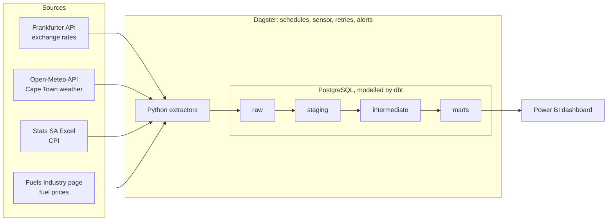

# SA Economy Pulse


An orchestrated data pipeline that tracks the numbers South Africans feel every month — the rand, the petrol price and inflation — and asks a simple question: **does a weaker rand show up at the pump?**

Four public sources are extracted daily, modelled in dbt into a tested star schema, scheduled and monitored by Dagster, and visualised in Power BI.

<!-- TODO: add the dashboard screenshot once it exists -->
[Dashboard](docs/dashboard.png) 

---

## The finding

In the 12 months to November 2026, **the rand explained surprisingly little of the petrol price**:

- The clearest link: the rand weakened **4.5% in March 2026**, and Gauteng 95 petrol rose **R3.06 in April**.
- But petrol moved in the same direction as the previous month's rand only **5 times out of 12** (correlation 0.39).
- The two biggest increases — **+R3.27 in May** and **+R3.33 in October** — came after months when the rand barely moved.

The rand stayed between roughly R16.0 and R16.8 per dollar all year while petrol hit record highs, which points to the **oil price** as the bigger driver in 2026. Twelve months is a small sample, so this is an observation, not a conclusion — adding Brent crude as a fifth source is the obvious next step.

---

## Architecture



<!-- TODO: add the Dagster lineage screenshot -->
<!--  -->

| Layer | Tool | What it does |
|---|---|---|
| Extract | Python (requests, pandas, BeautifulSoup) | One script per source, incremental and safe to re-run |
| Store | PostgreSQL 16 in Docker | `raw`, `staging`, `intermediate` and `marts` schemas |
| Transform | dbt Core 1.12 + dbt_utils | 16 models, 2 seeds, 71 tests |
| Orchestrate | Dagster | Asset lineage, schedules, a file sensor, retries, failure alerts |
| CI | GitHub Actions | Builds and tests every dbt model on every push |
| Visualise | Power BI | Reads the marts |

---

## Data sources

| Source | Data | How it's loaded | Schedule |
|---|---|---|---|
| [Frankfurter API](https://frankfurter.dev/) | ZAR vs USD, EUR, GBP | Incremental with a 3-day lookback | Daily, 07:00 SAST |
| [Open-Meteo archive](https://open-meteo.com/) | Cape Town daily weather | Incremental; archive runs about 5 days behind | Daily, 07:00 SAST |
| [Stats SA](https://www.statssa.gov.za/?page_id=1847) | CPI by COICOP category, monthly since 2008 | Excel file dropped in a landing folder, loaded by a sensor | When a new file appears |
| [Fuels Industry Association](https://fuelsindustry.org.za/consumer-information/fuel-prices-current-past/) | Petrol, diesel, paraffin and LPG prices, coastal and Gauteng | Dated HTML snapshot, then parsed | Weekly, Wednesdays |

---

## Data model

| Layer | Models |
|---|---|
| Staging (views) | `stg_fx_rates`, `stg_weather_daily`, `stg_cpi_series`, `stg_cpi_values`, `stg_fuel_prices` |
| Intermediate (views) | `int_fx_rates_filled` (weekend and holiday gaps carried forward), `int_cpi_inflation` (year-on-year and month-on-month), `int_fuel_prices_monthly` |
| Marts (tables) | `dim_date`, `dim_currency`, `dim_fuel_product`, `fct_fx_daily` and `fct_weather_daily` (incremental), `fct_cpi_monthly`, `fct_fuel_prices`, `mart_economy_monthly` |

`mart_economy_monthly` is the headline table: one row per month with the average USD/ZAR rate, Gauteng petrol and diesel prices, headline CPI inflation and Cape Town weather. Its `usd_zar_change_pct_prev_month` column lines up each month's pump price change with the **previous** month's rand move, because South African fuel prices are set from the prior month's exchange rate and oil price.

---

## Data quality: what the pipeline caught

Real sources are messy. These are problems the pipeline found in official data, and how each was handled:

- **Duplicate CPI series.** Stats SA's file lists 5 series twice under different headings (e.g. "CPI Headline" and "All Items"). The loader only keeps one after proving the two rows match in all 225 months — if they ever differ, the load stops.
- **A 10x typo on an official page.** Coastal LPG for July 2025 is published as 32,361 cents/kg (about R324) between neighbours of about R33. The fuel loader quarantines out-of-range values with a logged warning and loads the rest — but fails the whole run if more than 5 values are rejected, since that suggests a layout change, not a typo.
- **Hidden tables.** The current year's fuel prices sit in tables styled `display: none`, which `pandas.read_html` silently skips. Parsing with BeautifulSoup row by row reads everything on the page.
- **Gaps that hide problems.** The exchange-rate model fills weekends and holidays with the last known rate. A row-count check placed *after* that step could never see a missing currency, so the custom `daily_row_count_drift` test runs on the published rates in staging instead.

The dbt project has 71 tests in total: uniqueness, not-null, accepted values, relationships between facts and dimensions, value ranges, source freshness and the custom drift test. `dbt build` runs them in dependency order, so bad data stops before it reaches the marts.

---

## Running it yourself

**Prerequisites:** Docker, Python 3.12, git. Developed on WSL (Ubuntu).

```bash
git clone https://github.com/K1ng-cop/sa-economy-pulse.git
cd sa-economy-pulse

# 1. Configure: copy the example and set a password (and a free port if 5432 is taken)
cp .env.example .env

# 2. Start Postgres
docker compose up -d

# 3. Python environment
python3 -m venv .venv
source .venv/bin/activate
pip install -r requirements.txt

# 4. Load the data (the first run backfills about 3 years)
python -m extract.fx
python -m extract.weather
python -m extract.fuel --download
# CPI: download "CPI(COICOP) from Jan 2008" (Excel) from Stats SA,
# unzip it into data/landing/cpi/, then:
python -m extract.cpi

# 5. Build and test the models
cd dbt
set -a; source ../.env; set +a
dbt deps
dbt build
cd ..

# 6. Run the orchestrator (UI at http://localhost:3000)
export DAGSTER_HOME=$(pwd)/.dagster
dagster dev -f orchestration/definitions.py
```

Optional: set `ALERT_WEBHOOK_URL` in `.env` to a Slack or Discord webhook to get a message whenever a run fails.

---

## Project structure

```
sa-economy-pulse/
├── extract/               # one extractor per source, plus a shared DB connection
├── dbt/
│   ├── models/            # staging, intermediate and marts
│   ├── seeds/             # small lookup tables (currency and fuel product names)
│   ├── tests/             # range checks and the custom row-count drift test
│   └── macros/
├── orchestration/         # Dagster assets, jobs, schedules, sensors, alerts
├── scripts/               # profiling helpers and the CI database setup
├── docker/                # Postgres init script (schemas)
├── .github/workflows/     # CI
└── docker-compose.yml
```

---

## Limitations and next steps

- **Runs locally.** Schedules only run while `dagster dev` is running. In production this would run on a server or Dagster+.
- **CPI is downloaded by hand.** Stats SA has no API; a sensor picks up each new file automatically, but someone still has to drop it in.
- **CI tests structure, not data.** GitHub Actions builds every model against empty tables. Data problems are caught by the scheduled runs and the alerts.
- **Next:** add Brent crude oil prices to separate the rand effect from the oil effect, move to a cloud warehouse, and add pytest unit tests for the extractors' parsing logic.

---

Built by Kagiso Dlamini.